# Root causes of a stratified failure sample (navtest)

Sample, strata and labelling rules: `docs/FAILURE_TAXONOMY.md` (fixed before any case was
labelled). Each plan was rebuilt and scored with the unchanged official scorer against the
navtest metric cache; a case counts only if PDMS and all sub-scores reproduce the committed
per-scene row within 1e-4. Shares are descriptive, with Wilson 95% intervals; one case per log
per stratum. Per-case detail: `cases.csv`.

Reproduced: **120 of 120** failing plans (largest absolute sub-score error 4.8e-07).
Contrast plans reproduced: 72 of 72 (largest absolute sub-score error 5e-07).

| label | meaning | S1 rule map-fixed | S2 learned map-fixed | S3 box-induced | S4 learned residual | S5 rule residual |
|---|---|---|---|---|---|---|
| `dac_lateral_curve` | leaves the road sideways in a bend or turn | 2/24 (8%, 2-26%) | 4/24 (17%, 7-36%) | 4/24 (17%, 7-36%) | 3/24 (12%, 4-31%) | 3/24 (12%, 4-31%) |
| `dac_lateral_straight` | drifts off the road on a straight | 3/24 (12%, 4-31%) | 3/24 (12%, 4-31%) | 1/24 (4%, 1-20%) |  | 4/24 (17%, 7-36%) |
| `dac_overshoot` | runs past the end of the drivable path the human used |  |  | 1/24 (4%, 1-20%) |  |  |
| `dac_near_logged_path` | off-road while close to the logged path | 14/24 (58%, 39-76%) | 9/24 (38%, 21-57%) | 11/24 (46%, 28-65%) | 10/24 (42%, 24-61%) | 6/24 (25%, 12-45%) |
| `nc_rear_end` | drives into the object ahead in its lane | 2/24 (8%, 2-26%) | 3/24 (12%, 4-31%) | 5/24 (21%, 9-40%) | 9/24 (38%, 21-57%) | 5/24 (21%, 9-40%) |
| `nc_crossing` | collides with crossing or turning traffic |  | 1/24 (4%, 1-20%) |  | 1/24 (4%, 1-20%) | 3/24 (12%, 4-31%) |
| `nc_lateral` | side collision while straddling lanes or off-road |  | 2/24 (8%, 2-26%) |  |  |  |
| `nc_static` | hits a static object | 1/24 (4%, 1-20%) | 1/24 (4%, 1-20%) |  | 1/24 (4%, 1-20%) | 2/24 (8%, 2-26%) |
| `ttc_following` | closes in on the object ahead (TTC < bound) | 1/24 (4%, 1-20%) |  |  |  |  |
| `ttc_crossing` | TTC infraction with crossing traffic | 1/24 (4%, 1-20%) | 1/24 (4%, 1-20%) | 2/24 (8%, 2-26%) |  | 1/24 (4%, 1-20%) |

## How marginal are the drivable-area failures? (descriptive)

For every reproduced case whose primary failure is DAC: the distance of the simulated plan from
the logged path at the first off-road step, and how far the worst ego corner gets outside the
polygons the DAC check uses (roadblocks, intersections, car parks) over the rest of the 4-s
horizon. Not part of the pre-registered labels.

The last column counts failures whose off-road corners, at the first off-road step, all lie
inside a mapped lane or lane-connector polygon that the DAC polygons do not cover.

| stratum | DAC-primary cases | median distance to logged path | median max corner outside | max corner < 0.1 m outside | max corner < 0.5 m outside | off-road corner on a mapped lane |
|---|---:|---:|---:|---:|---:|---:|
| S1 | 19 | 0.46 m | 1.00 m | 3 of 19 | 5 of 19 | 0 of 19 |
| S2 | 16 | 0.66 m | 0.83 m | 3 of 16 | 5 of 16 | 0 of 16 |
| S3 | 17 | 0.61 m | 0.35 m | 5 of 17 | 13 of 17 | 0 of 17 |
| S4 | 13 | 0.47 m | 0.54 m | 1 of 13 | 6 of 13 | 0 of 13 |
| S5 | 13 | 1.12 m | 0.69 m | 1 of 13 | 5 of 13 | 0 of 13 |
| all | 78 | 0.63 m | 0.62 m | 13 of 78 | 34 of 78 | 0 of 78 |

## Box-induced failures (S3): how the boxes model plan differs from the map-only plan

| difference | cases |
|---|---:|
| slower | 2 |
| faster | 4 |
| lateral | 10 |
| similar | 8 |

## Gallery

Selection rule (pre-registered): per stratum the two reproduced cases with the most common
label, plus one case of the second most common label in S2 and S3, in hash order. Map
polygons, route lanes, centerline and agents come from the metric cache (map radius 50 m).

### 1. S1, `kin`: off-road while close to the logged path

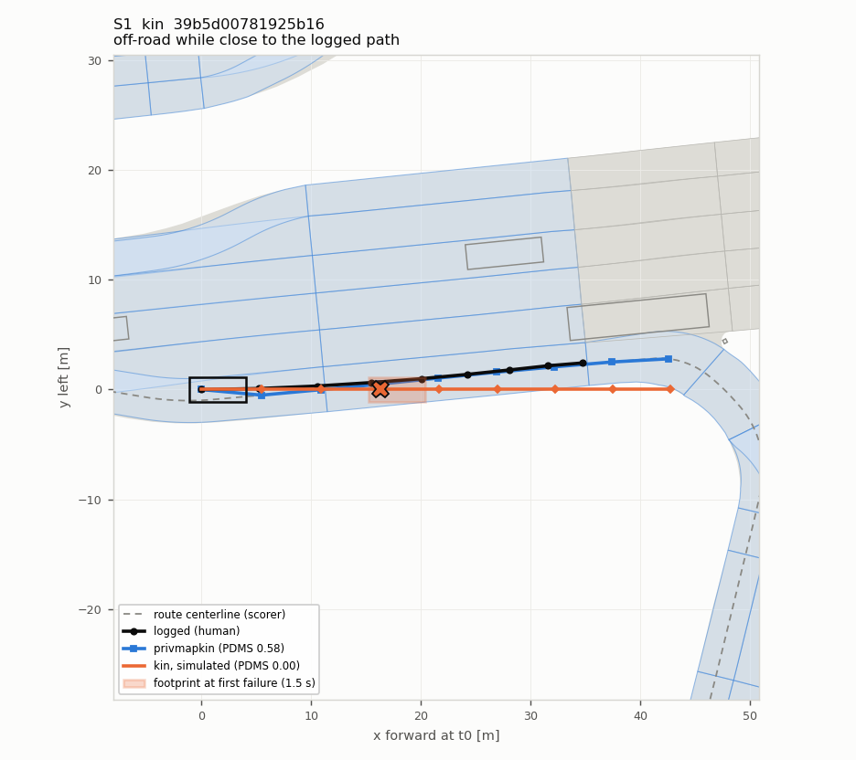

`39b5d00781925b16`, vegas, 10.9998 m/s, command straight, lead none, junction in, curvature straight, stop/go moving. kin PDMS 0.000 (NC 1.0, DAC 0, TTC 1, EP 0.00, C 1); privmapkin PDMS 0.583. Selected as S1: most common label.

### 2. S1, `kin`: off-road while close to the logged path

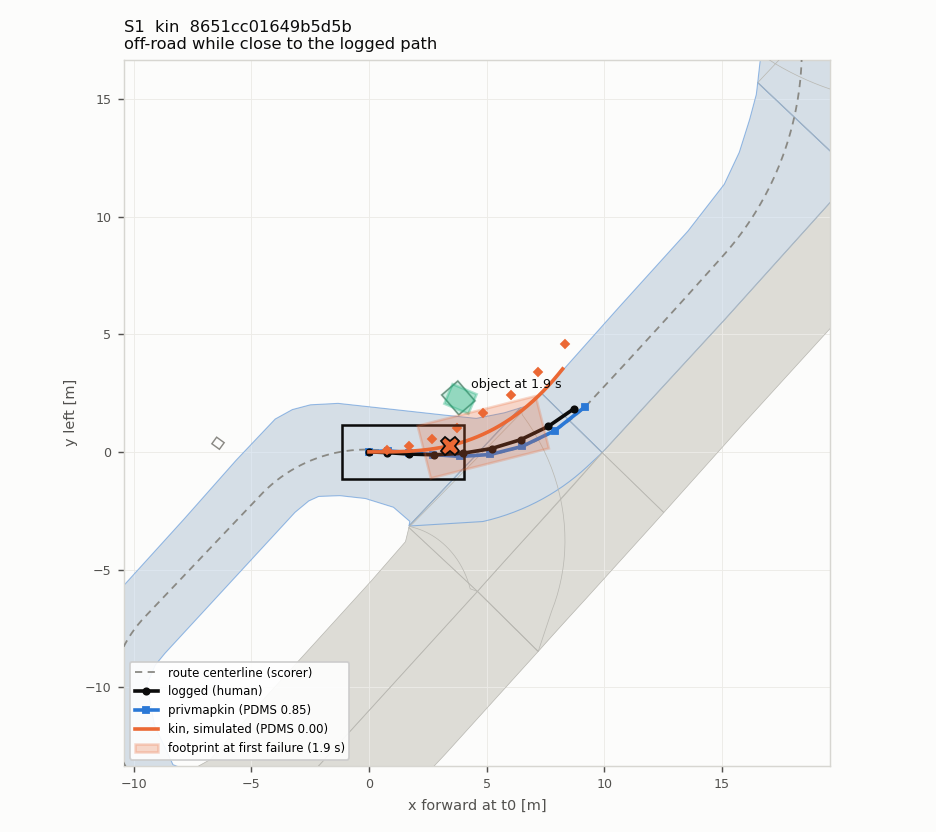

`8651cc01649b5d5b`, singapore, 1.3325 m/s, command left, lead close, junction near, curvature turn, stop/go moving. kin PDMS 0.000 (NC 0.0, DAC 0, TTC 0, EP 0.00, C 1); privmapkin PDMS 0.847. Selected as S1: most common label.

### 3. S2, `l_pose_kin_s2`: off-road while close to the logged path

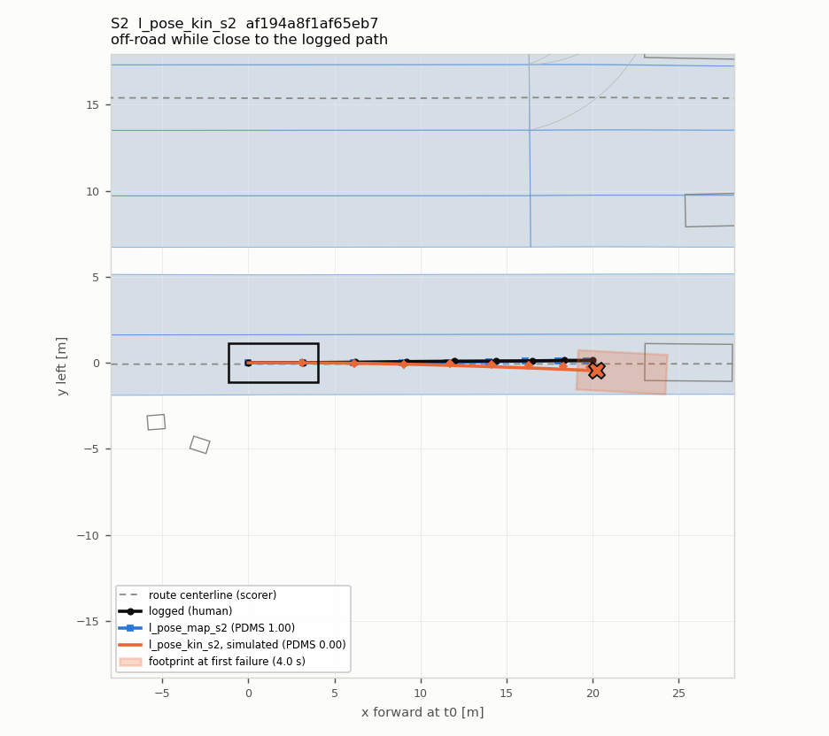

`af194a8f1af65eb7`, vegas, 6.5105 m/s, command straight, lead mid, junction none, curvature straight, stop/go moving. l_pose_kin_s2 PDMS 0.000 (NC 1.0, DAC 0, TTC 1, EP 0.00, C 1); l_pose_map_s2 PDMS 1.000. Selected as S2: most common label.

### 4. S2, `l_pose_kin_s0`: off-road while close to the logged path

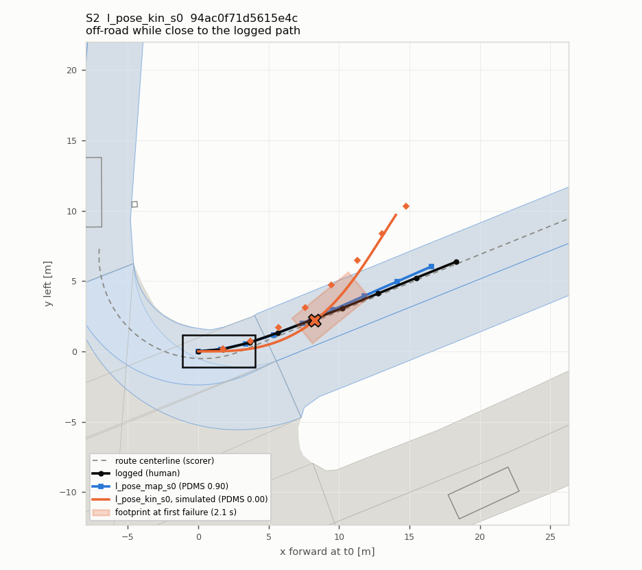

`94ac0f71d5615e4c`, singapore, 3.4846 m/s, command left, lead none, junction in, curvature bend, stop/go moving. l_pose_kin_s0 PDMS 0.000 (NC 1.0, DAC 0, TTC 1, EP 0.00, C 1); l_pose_map_s0 PDMS 0.897. Selected as S2: most common label.

### 5. S2, `l_pose_kin_s0`: leaves the road sideways in a bend or turn

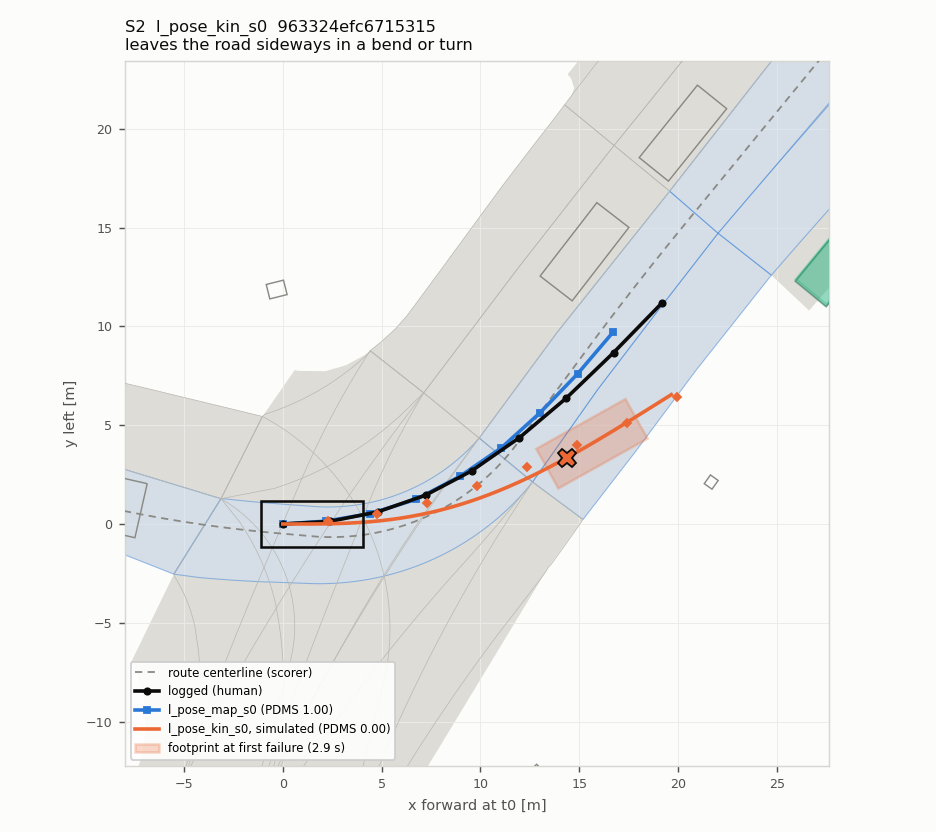

`963324efc6715315`, boston, 4.7078 m/s, command left, lead none, junction in, curvature turn, stop/go moving. l_pose_kin_s0 PDMS 0.000 (NC 1.0, DAC 0, TTC 0, EP 0.00, C 1); l_pose_map_s0 PDMS 1.000. Selected as S2: second most common label.

### 6. S3, `l_pose_map_agents_s0`: off-road while close to the logged path

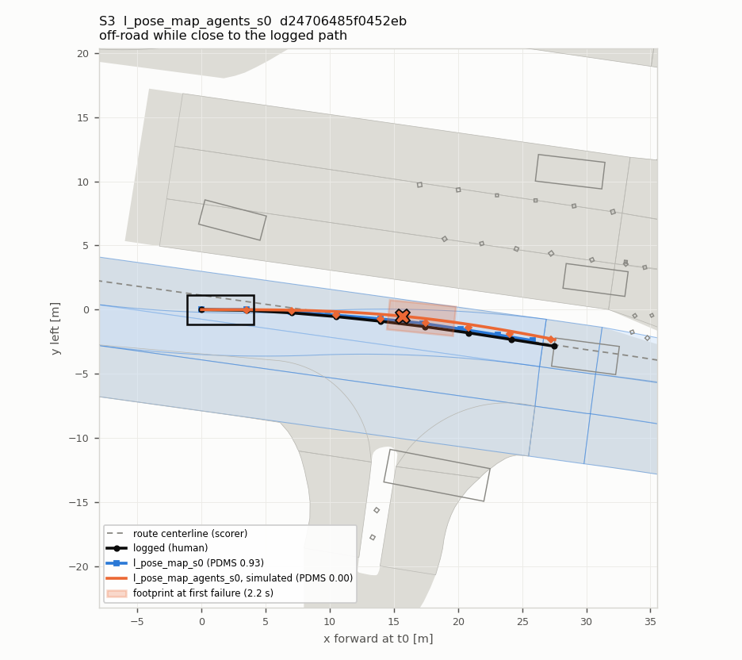

`d24706485f0452eb`, vegas, 7.2884 m/s, command straight, lead mid, junction in, curvature straight, stop/go moving. l_pose_map_agents_s0 PDMS 0.000 (NC 1.0, DAC 0, TTC 1, EP 0.00, C 1); l_pose_map_s0 PDMS 0.927. Selected as S3: most common label.

### 7. S3, `l_pose_map_agents_s0`: off-road while close to the logged path

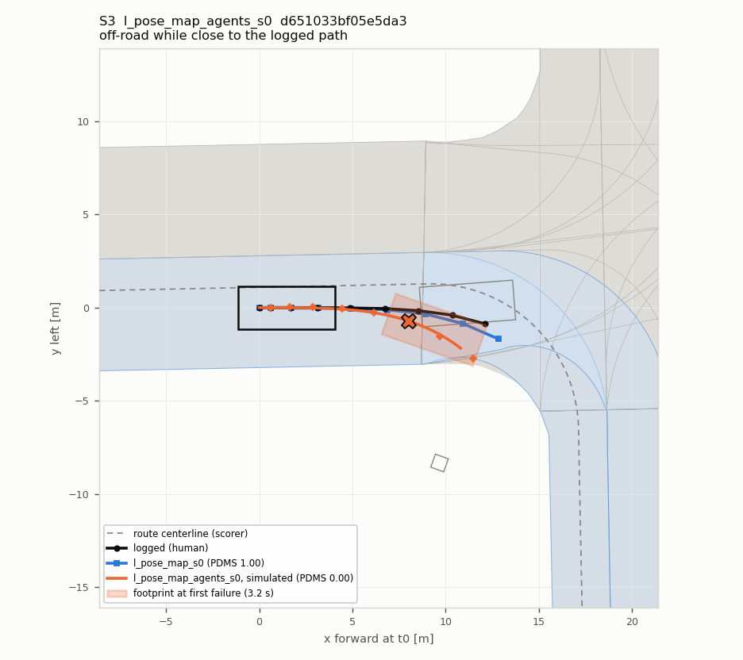

`d651033bf05e5da3`, pittsburgh, 0.7922 m/s, command right, lead close, junction near, curvature turn, stop/go starting. l_pose_map_agents_s0 PDMS 0.000 (NC 1.0, DAC 0, TTC 1, EP 0.00, C 1); l_pose_map_s0 PDMS 1.000. Selected as S3: most common label.

### 8. S3, `l_pose_map_agents_s1`: drives into the object ahead in its lane

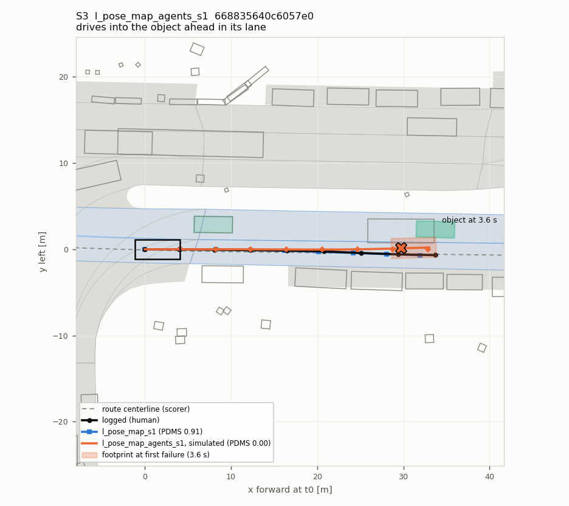

`668835640c6057e0`, boston, 8.4138 m/s, command straight, lead mid, junction in, curvature straight, stop/go moving. l_pose_map_agents_s1 PDMS 0.000 (NC 0.0, DAC 1, TTC 0, EP 0.00, C 1); l_pose_map_s1 PDMS 0.906. Selected as S3: second most common label.

### 9. S4, `l_pose_map_s0`: off-road while close to the logged path

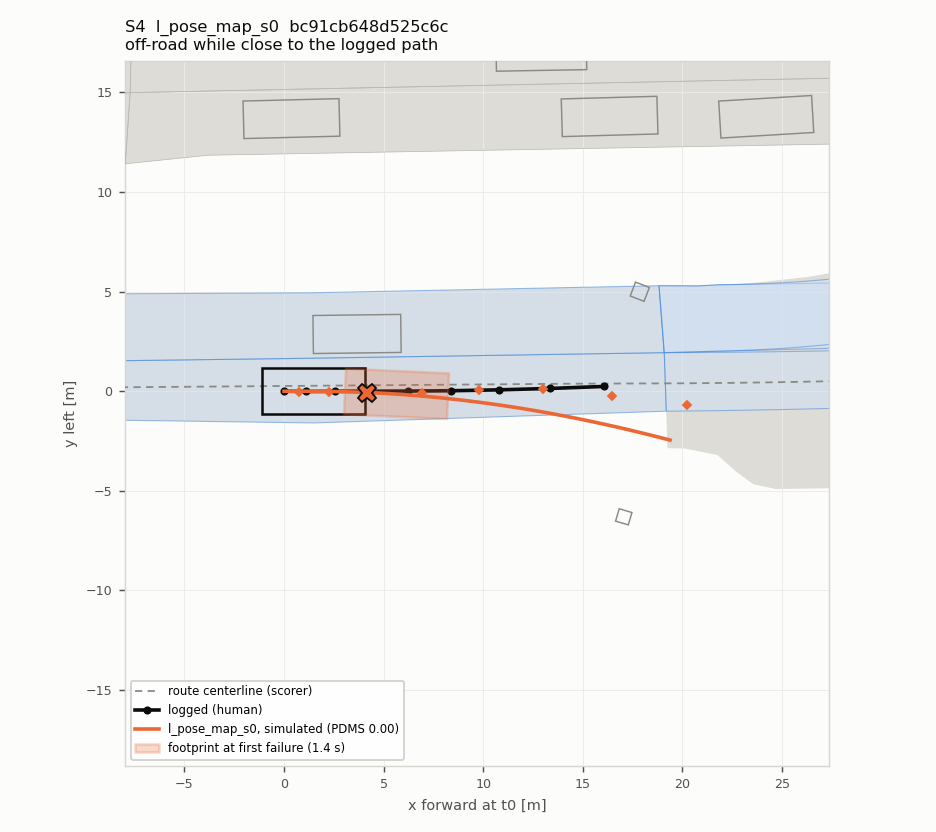

`bc91cb648d525c6c`, boston, 1.8751 m/s, command straight, lead mid, junction none, curvature straight, stop/go moving. l_pose_map_s0 PDMS 0.000 (NC 1.0, DAC 0, TTC 1, EP 0.00, C 1). Selected as S4: most common label.

### 10. S4, `l_pose_map_s2`: off-road while close to the logged path

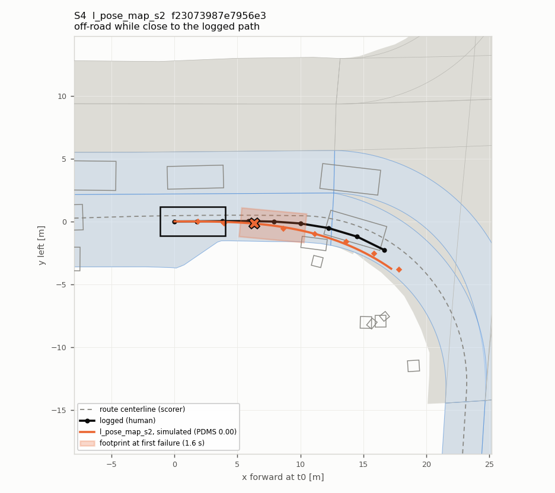

`f23073987e7956e3`, boston, 3.2131 m/s, command right, lead close, junction near, curvature turn, stop/go moving. l_pose_map_s2 PDMS 0.000 (NC 1.0, DAC 0, TTC 1, EP 0.00, C 1). Selected as S4: most common label.

### 11. S5, `privmapkin`: off-road while close to the logged path

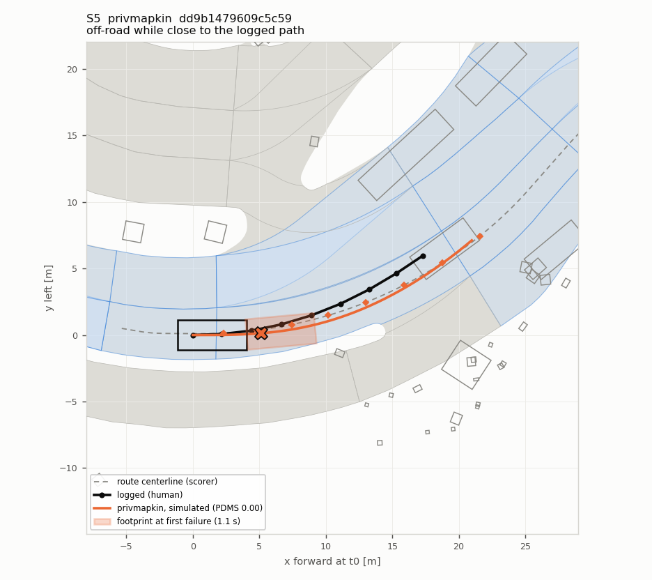

`dd9b1479609c5c59`, vegas, 4.3349 m/s, command left, lead close, junction near, curvature turn, stop/go moving. privmapkin PDMS 0.000 (NC 1.0, DAC 0, TTC 1, EP 0.00, C 1). Selected as S5: most common label.

### 12. S5, `privmapkin`: off-road while close to the logged path

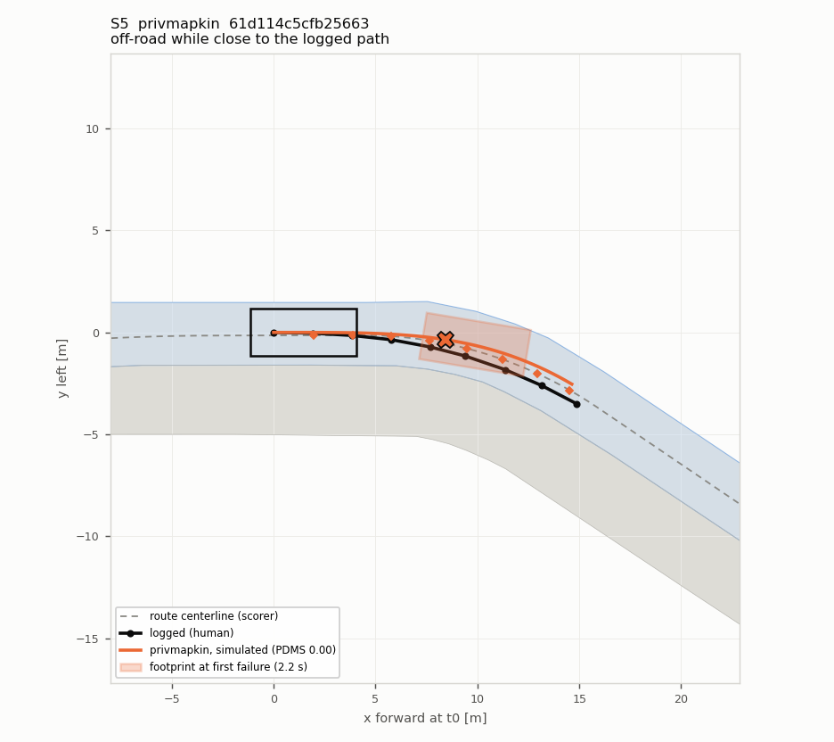

`61d114c5cfb25663`, singapore, 3.9468 m/s, command right, lead none, junction none, curvature bend, stop/go moving. privmapkin PDMS 0.000 (NC 1.0, DAC 0, TTC 1, EP 0.00, C 1). Selected as S5: most common label.

